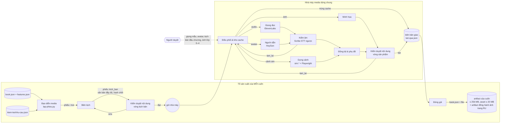

# Tổ sản xuất media của mỗi cuốn và nhà máy dùng chung (v0.9 nháp)

Mỗi cuốn có một **tổ sản xuất** riêng. Tổ đọc `book.json` và `features.json` của cuốn, lập phiếu, viết kịch bản, rồi gửi phiếu cho **nhà máy media dùng chung**. Nhà máy gọi công cụ ngoài (ElevenLabs, HeyGen, Playwright, công cụ tạo ảnh), kiểm tra kết quả và trả biên bản giao. Nhà máy không làm lại file đã có, nhờ `source_hash` (xem `quy-tac-cache.md`).

Các hợp đồng dữ liệu:
- `danh-muc-loai-media.json`: các loại hàng có thể đặt (`media.*`).
- `phieu-dat-hang.schema.json`: phiếu đặt hàng, vòng đời `moi → kich_ban → san_xuat → kiem_tra → dat|lam_lai → giao`.
- `ket-qua.schema.json`: biên bản giao. Phần `clips` theo đúng `$defs.clip` của book.schema, nên chép thẳng được vào `media.clips`.

## Sơ đồ

Agent nào ở đâu: **trong tổ của cuốn** có Đạo diễn, Biên kịch, Kiểm duyệt (vòng kịch bản) và Đóng gói. **Trong nhà máy** có Điều phối & kho, Giọng đọc, Kiểm âm, Dựng cảnh, Người dẫn, Minh họa, Đồng bộ & phụ đề và Kiểm duyệt (vòng sản phẩm). Kiểm duyệt là một vai, chạy hai vòng.

Ai được đổi trạng thái phiếu:

| Trạng thái | Ai đặt | Điều kiện |
|---|---|---|
| `moi` | Đạo diễn | phiếu hợp lệ schema |
| `kich_ban` | Biên kịch | có văn bản đầy đủ (`source.text`/`sentences`/`video`), `hash_status=chot` |
| `san_xuat` | Điều phối | giọng/avatar đã duyệt, không trúng cache |
| `kiem_tra` | agent sản xuất | đã có file trong kho |
| `dat` / `lam_lai` | Kiểm âm, Kiểm duyệt | mọi check `dat` hoặc `bo_qua`; `lam_lai` phải có `redo_reason` |
| `giao` | Điều phối | biên bản đầy đủ; hoặc `moi → giao` khi trúng cache |

Giới hạn làm lại: sau 3 lần `lam_lai` (`attempt ≥ 3`), phiếu dừng lại và chờ người xem.

---

## Đặc tả từng agent

Mỗi agent có bản hướng dẫn chạy ngắn ở `agents/<vai-tro>.md`.

### 1. Đạo diễn media (tổ của cuốn)
- **Đầu vào:** `kiem-ke/nhu-cau.json` (M1), `book.json`, `features.json` (axes 3, 6, 8, 9 cho biết cuốn bật những loại media nào), `danh-muc-loai-media.json`, danh sách giọng đã duyệt (`--giong`).
- **Đầu ra:** `phieu/<cuon>/*.json` và `phieu/_tong-hop.{json,csv}`, sinh bằng `lap-phieu.py`.
- **Quy tắc:** chỉ lập phiếu cho điểm `thieu` hoặc `chi_tts_trinh_duyet` (`cu` nếu chạy với `--gom-cu`). D2: mặc định KHÔNG lập cho điểm hình `mo_rong` (`--gom-mo-rong`) và câu `na=1`/no_read (`--gom-na1`). Không lập phiếu cho loại mà features của cuốn không bật. Mã phiếu `order_id` ổn định, chạy lại không sinh phiếu trùng. Ưu tiên: uz=1, ru=2, kaa=3, vi=4; sfx, ảnh và video người dẫn bị cộng thêm điểm, tức là ưu tiên thấp hơn. Ước lượng phút và MB trước khi gửi, rồi báo Đóng gói nếu có nguy cơ vượt 256 MB.
- **Xong khi:** 0 lỗi schema, mỗi điểm cần media có đúng một phiếu cho mỗi ngôn ngữ, bảng tổng hợp có công thức ước lượng.
- **Người duyệt:** chốt thứ tự ưu tiên và ngân sách MB của từng cuốn.

### 2. Biên kịch (tổ của cuốn)
- **Đầu vào:** phiếu `moi`, `book.json` (lấy văn bản đầy đủ theo `text_path`), `tri-thuc/cap-tuoi.md`, `tri-thuc/thuat-ngu.csv`, `thu-vien/mo-phong/danh-muc.json` (cho video mã).
- **Đầu ra:** phiếu `kich_ban` có `source.text` (NFC), hoặc `sentences` (đọc theo câu), hoặc `video` (đúng `$defs/video`), hoặc kịch bản người dẫn / prompt ảnh. Kèm `constraints.lexicon`, danh sách `term.*` có trong văn bản.
- **Quy tắc:**
  - Thuyết minh trang/khối: đọc đúng chữ đang hiển thị, không thêm ý.
  - Lời viết mới (cảnh video, người dẫn) theo `cap-tuoi.md`: lớp 5 trung vị 7–8 từ uz/câu, lớp 8 là 9–10 từ. Mỗi cảnh không quá 2 câu và không quá 30 giây. Lớp 5 xưng "em" (vi), bản uz giữ "siz".
  - Thuật ngữ phải dùng đúng dạng trong `thuat-ngu.csv`.
  - Số, công thức và ký hiệu hóa học viết ra chữ để đọc, ví dụ "H₂O" hay "5 m/s" đọc theo quy ước của từng ngôn ngữ, có bảng quy ước riêng cho mỗi môn. Bản chuyển này lưu ở `source.text`; bản hiển thị giữ nguyên.
  - Prompt ảnh không chứa chữ, người thật hay thương hiệu.
  - Tính lại `text_hash` và `source_hash`, đặt `hash_status=chot`.
- **Xong khi:** phiếu hợp lệ schema ở trạng thái `kich_ban`, mọi thuật ngữ đã gắn `term.*`.
- **Người duyệt:** giáo viên bộ môn duyệt kịch bản video đầu tiên của mỗi chương và mọi kịch bản người dẫn.

### 3. Giọng đọc – TTS (nhà máy)
- **Đầu vào:** phiếu `san_xuat` loại audio, giọng đã duyệt, từ điển phát âm (thuật ngữ khó do Kiểm âm sửa).
- **Đầu ra:** bản gốc `mp3_44100_128` trong kho; bản giao `mp3_mono_44k_64` (D2: chỉ 64 kbps) chuẩn hóa -16 LUFS; mốc ký tự hoặc mốc câu nếu nhà cung cấp trả về.
- **Quy tắc:** uz chỉ dùng `eleven_v3` (schema bắt buộc). Giữ một giọng cho mỗi persona × ngôn ngữ trong toàn bộ sách. Gửi theo câu hoặc theo clip, không gửi cả chương. Ghi `request_id`. Không gọi lại khi `source_hash` đã có trong kho. `kaa`: chưa xác minh nhà cung cấp có hỗ trợ (D2: giữ chỗ, không sản xuất tới khi thử nghiệm giọng kaa được người duyệt), phải hỏi người trước.
- **Xong khi:** mỗi clip có file trong kho, thời lượng nằm trong 0,6–1,6 lần `expected_seconds`.
- **Người duyệt:** duyệt **giọng mẫu cho mỗi ngôn ngữ × persona** (một đoạn 30 giây có thuật ngữ) trước khi chạy hàng loạt. Đây là điểm chặn: chưa duyệt thì `voice_id=chua_chot` và hash ở trạng thái `tam_tinh`.

### 4. Kiểm âm (nhà máy)
- **Đầu vào:** file audio, văn bản nguồn, `constraints.lexicon`, ngưỡng `stt_cer_max`.
- **Đầu ra:** các check `stt_cer`, `term_pronunciation`, `loudness_lufs`, `true_peak_dbtp`, `duration_ratio`, `leading_silence` trong biên bản, cùng `transcript`.
- **Quy tắc:** chạy Scribe với ngôn ngữ chỉ định. Chuẩn hóa hai phía (thường hóa, bỏ dấu câu, số chuyển thành chữ) trước khi tính CER. Thuật ngữ không khớp thì thử thêm gợi ý phát âm và `lam_lai` tối đa 2 lần, sau đó chuyển `can_nguoi`. Ngưỡng CER (duyệt D2): uz 0,08, ru 0,05, vi 0,06, kaa 0,10, cần hiệu chỉnh bằng 50 clip mẫu cho mỗi ngôn ngữ.
- **Xong khi:** mọi check `dat`, hoặc `lam_lai` có lý do cụ thể (câu nào, từ nào).
- **Người duyệt:** người bản ngữ nghe ngẫu nhiên 5% số clip mỗi đợt và mọi thuật ngữ bị đánh dấu `KIEM_TRA`.

### 5. Dựng cảnh (nhà máy)
- **Đầu vào:** `media.code_video` (video JSON) hoặc `media.sim_recording_mp4`, thư viện `sim.*`, clip thuyết minh đã đạt.
- **Đầu ra:** video JSON đã kiểm tra tham số; khi có đặt hàng thì thêm MP4 H.264 720p, AAC 64k.
- **Quy tắc:** mọi `visual.kind` phải có trong 57 `sim.*`, `params` đúng khai báo. Thời lượng cảnh bằng max(`min_seconds`, độ dài audio). Quay bằng Playwright với đồng hồ giả, để khung hình tất định và cùng đầu vào cho ra cùng file. Không đưa MP4 vào artifact nếu bản tương tác đã có; MP4 chỉ dành cho `downloads` hoặc kênh ngoài.
- **Xong khi:** `schema_valid` và `sim_params_valid` đạt; với MP4 thì thêm `black_frames`, `sync_drift` ≤ 100 ms và size dưới trần.
- **Người duyệt:** không bắt buộc; Kiểm duyệt sẽ xem kiến thức.

### 6. Người dẫn – HeyGen (nhà máy)
- **Đầu vào:** kịch bản người dẫn (≤ 150 từ, ≤ 90 giây), `avatar_id` và giọng đã duyệt.
- **Đầu ra:** MP4 960×540, ≤ 18 MiB, phụ đề VTT do Đồng bộ sinh.
- **Quy tắc:** mỗi bộ sách dùng một avatar. Trang phục và cử chỉ phải phù hợp văn hóa Uzbekistan. Không dùng hình hay giọng người thật nếu chưa có văn bản đồng ý. Kiểm âm chạy STT ngược trên track tiếng.
- **Xong khi:** `stt_cer` đạt và người duyệt chấp nhận khớp môi.
- **Người duyệt:** **duyệt avatar và persona** một lần cho mỗi bộ sách, duyệt video đầu tiên của mỗi ngôn ngữ, duyệt quyền hình ảnh.

### 7. Minh họa (nhà máy)
- **Đầu vào:** prompt ảnh (Biên kịch), ảnh mẫu phong cách của bộ sách, cấp lớp.
- **Đầu ra:** WebP ≤ 300 KB, cạnh dài ≤ 1600 px.
- **Quy tắc:** ưu tiên cắt hoặc làm sạch từ ảnh trang (`sim.scene_page_image`) trước khi tạo ảnh mới. Ảnh không có chữ. Ghi `seed` và model để tái tạo được. Công cụ tạo ảnh chưa chốt.
- **Xong khi:** `no_text_in_image`, `content_age`, `content_facts`, `cultural_fit` đạt.
- **Người duyệt:** mọi ảnh cho lớp 0–4, mẫu phong cách đầu tiên của mỗi bộ sách.

### 8. Đồng bộ & phụ đề (nhà máy)
- **Đầu vào:** audio đã đạt, câu/clip có id, mốc từ TTS hoặc Scribe.
- **Đầu ra:** `sentence_marks` (đọc theo câu), `clips` (start/dur trong sprite), `scene_durations`, file VTT.
- **Quy tắc:** ghép sprite theo `target.sprite_group`, đệm lặng 250 ms giữa clip, mỗi sprite ≤ 18 MiB (ở 64 kbps khoảng 39 phút). Mốc lấy 3 chữ số thập phân. Câu `no_read` bỏ qua. VTT ≤ 42 ký tự mỗi dòng, ≤ 2 dòng, tốc độ ≤ 17 ký tự/giây (lớp 0–4: ≤ 12).
- **Xong khi:** `sentence_marks_valid` đạt (không chồng lấn, lệch ≤ 150 ms so với STT) và `vtt_valid` đạt.
- **Người duyệt:** không.

### 9. Kiểm duyệt nội dung (hai vòng: kịch bản ở tổ, sản phẩm ở nhà máy)
- **Đầu vào:** kịch bản, ảnh, video, cấp lớp, nội dung bài trong book.json.
- **Đầu ra:** các check `content_age`, `content_facts`, `no_answer_leak`, `cultural_fit` cùng quyết định.
- **Quy tắc:** đối chiếu kiến thức với sách gốc; lời thêm không được trái sách. Không lộ đáp án bài tập. Không có nội dung sợ hãi hay bạo lực với lớp 0–4. An toàn thí nghiệm phải khớp mục cảnh báo của sách. Tên riêng và trang phục phù hợp văn hóa.
- **Xong khi:** mọi check `dat`; phần nghi ngờ đánh `can_nguoi`.
- **Người duyệt:** giáo viên bộ môn xem các mục `can_nguoi`.

### 10. Đóng gói (tổ của cuốn)
- **Đầu vào:** biên bản `dat` hoặc `giao`, file trong kho, `book.json`, danh sách file hiện có của artifact (chỉ đọc).
- **Đầu ra:** bản đề xuất cập nhật `book.json` (`media.clips`, `media.files` với `source_hash`, `fallback_tts`), cây file `audio/<lang>/`, `video/`, `img/`, `sub/`, và báo cáo dung lượng.
- **Quy tắc:** ước lượng tổng MB trước khi đặt file. Audio giao 64 kbps (D2). Vượt 230 MB thì chuyển ảnh trang bản in thứ hai (`pages_ru/`) sang artifact đồng hành (`book.asset_sources`, tiền tố `@<nguồn>/`), rồi gỡ file thừa; vẫn vượt 256 MB thì báo người. Không hạ bitrate. Không đặt file không được tham chiếu, và liệt kê file thừa để gỡ (ví dụ `audio/` của tabiiy5, fx của biologiya5). Không publish; việc publish do người hoặc điều phối dự án làm.
- **Xong khi:** mọi clip trong book.json trỏ tới file có thật, mọi tiền tố `@<nguồn>/` có trong `asset_sources`, mỗi artifact (chính, đồng hành) ≤ 256 MB, mỗi asset ≤ 20 MB, không còn file mồ côi.
- **Người duyệt:** duyệt trước khi publish bản có thay đổi audio.

### 11. Điều phối & kho cache (nhà máy)
- **Đầu vào:** phiếu `kich_ban` từ các cuốn, `chi-muc-cache.json`.
- **Đầu ra:** phiếu `san_xuat` hoặc `giao` (khi trúng cache), hàng đợi theo `priority`, sổ chi phí.
- **Quy tắc:** chỉ tra cache khi `hash_status=chot`. Gộp phiếu cùng `source_hash` từ nhiều cuốn thành một lần sản xuất. Giới hạn đồng thời theo nhà cung cấp. Nhật ký chi phí tính theo ký tự và giây.
- **Xong khi:** mọi phiếu ở trạng thái cuối hoặc có lý do chờ.
- **Người duyệt:** ngân sách credit mỗi đợt.
